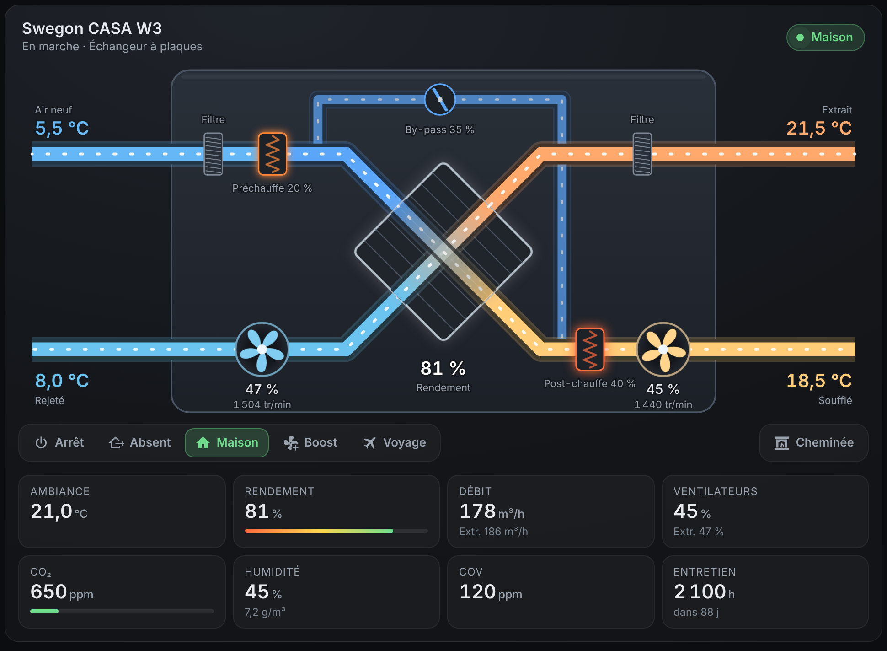

# Swegon CASA pour Home Assistant

Intégration Home Assistant **locale** pour les centrales de ventilation double flux **Swegon CASA** (contrôleur SCB 3.0 et plus récent : W3, R3, R5, R15…), en **Modbus RTU** (adaptateur USB RS-485) ou **Modbus TCP** (passerelle).

- **Toutes les variables** de la table Modbus Swegon SCB 3.x : environ 150 entités (températures, qualité d'air, débits, ventilateurs, roue, by-pass, dégivrage, alarmes, fonctions Smart, réglages).
- **Ventilateur** avec les modes Absent, Maison, Boost et Voyage, pour les tableaux de bord et les assistants vocaux.
- **Carte de tableau de bord** livrée avec l'intégration : schéma animé de la centrale avec les quatre flux d'air et leurs températures, l'échangeur (à plaques pour la série W, roue pour la série R), le by-pass avec son ouverture en %, les batteries de préchauffe et de post-chauffe avec leur puissance, les ventilateurs, les modes, la qualité d'air et les alarmes.
- **Détection automatique** de l'adresse esclave, de la numérotation des registres et de la version du logiciel (3.0 ou 3.1).
- **Seuls les équipements présents** créent des entités : sondes de qualité d'air, panneau, post-chauffage, préchauffage, hotte, aspiration centralisée, entrées/sorties GIO, réglages installateur.
- **Écritures vérifiées** : chaque réglage est contrôlé par rapport aux bornes de la documentation, puis relu après écriture.



## Câblage

| Élément | Réglage |
| --- | --- |
| Liaison | RS-485 (bornes A/B du connecteur Modbus de la carte SEM / SEC) |
| Vitesse | 38 400 bauds (par défaut) |
| Format | 8 bits, sans parité, 1 bit de stop |
| Adresse esclave | 1 (parfois 16), détectée automatiquement |
| Terminaison | Placer le cavalier **JP1** de la carte SEM en position terminaison ; la plupart des adaptateurs USB ont la leur |

Consultez la notice Swegon de votre carte SEM / SEC pour l'emplacement exact des bornes. Si rien ne répond, inversez A et B : c'est l'erreur la plus fréquente.

> Le port série ne peut être utilisé que par un seul programme. Si l'intégration Modbus de Home Assistant (YAML) utilise déjà ce port, retirez-la d'abord.

## Installation

**HACS (recommandé)** : HACS > menu ⋮ > Dépôts personnalisés > `https://github.com/Flost42600/ha-swegon-casa`, type « Intégration ». Installez « Swegon CASA », puis redémarrez Home Assistant.

**Manuelle** : copiez `custom_components/swegon_casa` dans le dossier `config/custom_components/`, puis redémarrez.

## Configuration

1. Paramètres > Appareils et services > Ajouter une intégration > **Swegon CASA**.
2. Choisissez **Adaptateur USB RS-485** ou **Passerelle Modbus TCP**.
3. Choisissez le port (de préférence le chemin `/dev/serial/by-id/…`, qui ne change pas au redémarrage). Laissez l'adresse esclave à **0** pour la détecter.
4. Cochez les **équipements** de votre centrale. Les sondes de qualité d'air et le panneau sont détectés et précochés quand c'est possible.

Les équipements et les intervalles de lecture (15 s pour les mesures, 60 s pour les réglages) se modifient ensuite via **Configurer**.

## Carte de tableau de bord

Elle est chargée automatiquement avec l'intégration : modifier le tableau de bord > Ajouter une carte > **Swegon CASA**, ou en YAML :

```yaml
type: custom:swegon-casa-card
```

Options : `title`, `device_id` (si plusieurs centrales) et `exchanger` (`plate` ou `rotor`, détecté d'après le modèle). Un clic sur un mode change le mode de fonctionnement, le bouton « Cheminée » lance la fonction cheminée, et « Acquitter » valide le remplacement du filtre.

## Entités principales

| Entité | Type | Registre |
| --- | --- | --- |
| Ventilation (modes Absent / Maison / Boost / Voyage) | ventilateur | 4x5001 |
| Mode de fonctionnement | sélecteur | 4x5001 |
| Réglage Smart (−100 à +100 %) | nombre | 4x5019 |
| Fonction cheminée, mode voyage, arrêt d'urgence | interrupteurs | 4x5002, 4x5004, 4x5018 |
| Pilotage auto par CO2 / humidité / COV | interrupteur / sélecteurs | 4x5009 à 4x5011 |
| Rafraîchissement nocturne | sélecteur + réglages | 4x5164 à 4x5170 |
| Températures air neuf, soufflé, extrait, rejeté, ambiante, panneau | capteurs | 3x6201 à 3x6208 |
| CO2, humidité relative et absolue, COV | capteurs | 3x6212 à 3x6217 |
| Débits et pressions de gaine | capteurs | 3x6218 à 3x6221 |
| État, niveau de ventilation, commande et vitesse des ventilateurs, roue, by-pass | capteurs | 3x6301 à 3x6348 |
| Rendement de récupération (calculé) | capteur | (T soufflé − T neuf) / (T extrait − T neuf) |
| Alarme active (liste en attribut), filtre, entretien, défauts ventilateurs, sondes, roue… | capteurs binaires | 3x6101 à 3x6150 |
| Acquitter : informations, filtre, entretien, défauts | boutons | 4x5401 à 4x5408 |
| Heures avant entretien | capteur | 3x6343 |

Les réglages installateur (vitesses par mode, corrections de sondes, visibilité sur le panneau) existent aussi, désactivés par défaut. La documentation Swegon déconseille de piloter les ventilateurs en continu par ces registres.

## Exemples d'automatisations

**Boost pendant la douche** quand l'humidité dépasse 75 % :

```yaml
alias: CASA – Boost humidité
triggers:
  - trigger: numeric_state
    entity_id: sensor.swegon_casa_w3_humidite_relative
    above: 75
actions:
  - action: fan.set_preset_mode
    target:
      entity_id: fan.swegon_casa_w3
    data:
      preset_mode: boost
```

**Mode Absent** quand tout le monde est parti :

```yaml
alias: CASA – Absent
triggers:
  - trigger: state
    entity_id: zone.home
    to: "0"
    for: "00:15:00"
actions:
  - action: select.select_option
    target:
      entity_id: select.swegon_casa_w3_mode_de_fonctionnement
    data:
      option: away
```

Valeurs du mode : `stopped`, `away`, `home`, `boost`, `travelling`.

## Dépannage

- **`/dev/ttyS0` ne répond pas** : c'est le port série intégré au PC, pas l'adaptateur USB. Choisissez l'adaptateur, en général `/dev/serial/by-id/usb-…` ou `/dev/ttyUSB0` (liste complète : Paramètres > Système > Matériel > Tout le matériel, filtre « tty »).
- **« La centrale ne répond pas »** : vérifiez le port, l'inversion A/B, le cavalier JP1, la vitesse (38 400) et que rien d'autre n'utilise le port.
- **Valeurs décalées** (le CO2 affiche l'humidité, par exemple) : la documentation Swegon numérote les registres à partir de 1. L'intégration détecte ce décalage ; les diagnostics indiquent celui qui a été retenu (`offset`).
- **Diagnostics** : page de l'intégration > ⋮ > Télécharger les diagnostics. Toutes les valeurs brutes y figurent ; le numéro de série est masqué.

## État du projet

Développé à partir de la table « Swegon CASA Smart ModBus Register SCB 3.0/3.1 », et testé avec un simulateur qui reproduit le comportement du bus (décalage d'adresse, registres absents, absence de réponse). Les retours sur d'autres modèles de CASA sont les bienvenus, avec un fichier de diagnostics.

## Développement

```bash
pip install pytest-homeassistant-custom-component pymodbus pyserial
pytest
python scripts/gen_translations.py   # après modification de registers.py
```

## Licence

MIT. Ce projet n'est ni affilié à Swegon ni soutenu par Swegon. Swegon et CASA sont des marques de leurs propriétaires respectifs.
